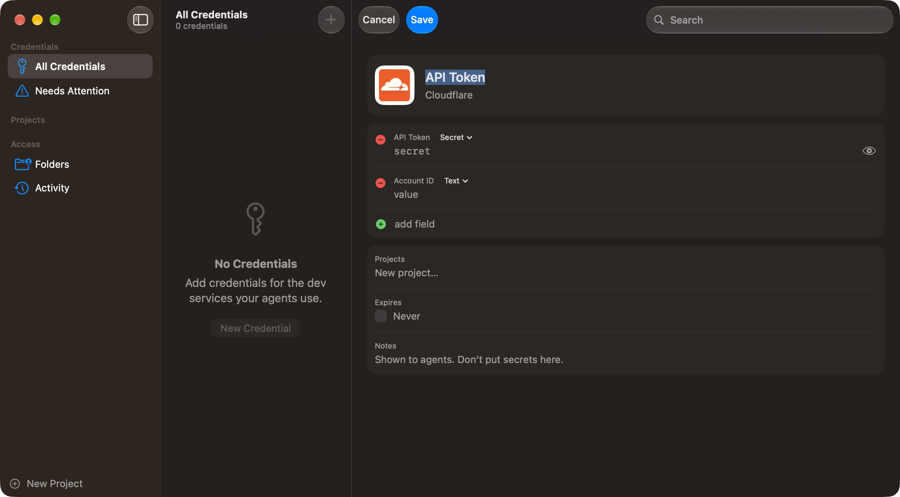
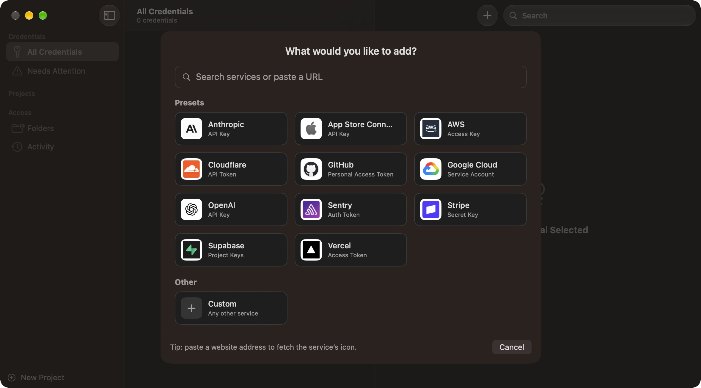

# Agent Secrets

A native macOS app that manages a curated set of development credentials in the Keychain and serves them to coding agents over MCP, scoped by project and authorised folder.





## Purpose

Coding agents need credentials for common dev services (Cloudflare, App Store Connect, etc.). Today this lives inside an existing coding tool. This app extracts it into a dedicated, single-purpose tool that:

- Stores only dev-service credentials, not the whole Keychain.
- Lets the owner manage them through a pleasant native UI.
- Serves them to agents via a local MCP server.
- Limits each agent to the credentials of the project it is working in.

It is built for a single user (the owner) and optimised for unattended, overnight agent runs: agents should never be blocked from credentials they legitimately need, and never able to reach credentials they don't.

## Non-goals

- No proxying of API calls. The server returns secrets; it does not know how to authenticate against each service.
- No cross-platform support or storage abstraction. Keychain-backed, macOS only.
- No per-access approval prompts (may be added later as an optional mode).

## Tech stack

- Swift, SwiftUI, native macOS app.
- macOS Keychain (Security framework) as the only secret store. Items are owned by the signed app.
- Local MCP server (stdio transport), shipped as a helper executable within the app bundle.

## Core concepts

### Service

A known dev service, e.g. Cloudflare, App Store Connect. Each service can define a schema of expected fields (e.g. App Store Connect: key ID, issuer ID, private key) and has its own visual presentation in the UI (icon, colour, styling).

### Credential

A named secret (or group of fields) belonging to a service, e.g. Cloudflare → "API token". Stored in the Keychain. Has metadata: name, service, notes, optional expiry date, created/updated timestamps.

### Project

Defined in the app, e.g. "Accelerate". Credentials are tagged with projects, many-to-many: one Cloudflare token covering several domains can be tagged with several projects.

### Authorised folder

A filesystem path the owner has granted access to a project. Agents running from within that folder get that project's credentials.

## Authorisation model

1. The owner creates projects and tags credentials with them in the app.
2. The owner grants a folder access: choose a project folder in the app (e.g. drag and drop or file picker) and assign it to a project.
3. The app records the mapping (absolute path → project) in its own registry, not in the repo.
4. Optionally, the app writes a small non-secret marker file into the folder containing only the project name, for discoverability. It must never contain a secret.
5. When an agent launches the MCP server, the server resolves its working directory (walking up to parent directories), looks it up in the registry, and binds the session to that project.
6. A bound session has unrestricted read access to every credential tagged with its project. No prompts.
7. An unbound session (unregistered folder) gets no credentials, and its tools return a clear error explaining that the folder isn't authorised.

The project is determined by the binding, never by an argument the agent supplies. This is what makes project scoping a real boundary and not just a filter.

## MCP tools

- `list_credentials`: returns metadata (service, name, fields, expiry) for credentials available to the bound project. Never returns secret values.
- `get_credential(service, name)`: returns the secret value(s) for a credential if it is tagged with the bound project.
- `whoami`: returns the bound project and folder, to help agents debug access.

Errors should be descriptive enough for an agent to act on without human help (e.g. "No credential 'API token' for service 'Cloudflare' in project 'Accelerate'. Available: …").

## App UI

- **Credentials:** list grouped by service with per-service visual styling. Add, edit and delete credentials, with fields driven by the service schema. Assign project tags. Expiry warnings.
- **Projects:** create and rename projects. View tagged credentials and authorised folders.
- **Folders:** grant and revoke folder access. Show the path, project and last access.
- **Activity log:** every MCP access with timestamp, folder, project, service and credential name. Values are never logged.

### Adding credentials

Entering credentials must be fast and clean, done entirely in the app. The owner never touches Keychain Access directly.

1. Enter a service name or paste its URL (e.g. `cloudflare.com`).
2. From a URL, the app fills in the service name and fetches the site's favicon or best available icon for the service's visual styling. The owner can edit both.
3. Pick the fields: either a known schema (e.g. App Store Connect) or a quick field list (name plus value, with secret fields masked). Support paste and file drop, e.g. a `.p8` key.
4. Tag with projects and save. The app writes the values to the Keychain itself.

If the icon can't be fetched, show a plain generated placeholder. Don't block the save.

## Security notes

- Secrets live only in the Keychain. The app's registry and metadata store holds no secret values.
- Never write secrets into project folders.
- Never log secret values.
- Revoking a folder or untagging a credential takes effect immediately for new requests.

## Sync and availability

The owner develops only on Macs, so cross-device sync uses iCloud Keychain. Items are stored as synchronizable (`kSecAttrSynchronizable`).

- Credential metadata (service, name, fields, project tags) must sync with the secrets. Otherwise a second Mac has values it can't present. Prefer keeping metadata in the Keychain item's own attributes, or in a synced store alongside it, so there is one source of truth.
- Authorised folders are per machine (absolute paths) and do not sync.
- Availability is checked against the Keychain, never assumed from metadata. A credential can be registered but missing, for example because it was deleted on another Mac, sync hasn't arrived yet, or iCloud Keychain is off.
- `list_credentials` reports each credential's availability (available or missing).
- `get_credential` fails fast with a specific error when the value is missing, e.g. "'API token' for Cloudflare is registered but not present in the Keychain on this Mac". No fallbacks.
- The UI flags missing credentials clearly so the owner can re-enter them.

## Initial services

- Cloudflare (API token)
- App Store Connect (key ID, issuer ID, .p8 private key)
- Generic (free-form named fields), so any other service can be added without code changes

## Migration

The existing coding tool currently accesses the Keychain directly. Once this app exists, that tool should be switched to consume credentials via this MCP server, and its built-in Keychain logic removed.

## Future ideas

- Optional approval modes (per access or per session).
- Expiry and rotation reminders.
- Import of existing Keychain items into the managed set.

## Development

The Xcode project is generated from `project.yml` with [XcodeGen](https://github.com/yonaskolb/XcodeGen):

```sh
xcodegen generate
open Secrets.xcodeproj
```

Releases are built, signed, notarized and published by GitHub Actions, with Sparkle for in-app updates. See [RELEASE.md](RELEASE.md).

### Layout

- `Secrets/Model`: projects, services, credentials, folder grants, activity entries, built-in service templates.
- `Secrets/Storage`: `Keychain` (Security framework wrapper), `Vault` (Keychain-backed store), folder registry, activity log and folder resolution.
- `Secrets/MCP`: the stdio MCP server.
- `Secrets/Views`: SwiftUI interface.

### Implementation notes

- **MCP server is the app binary.** Agents run `Agent Secrets.app/Contents/MacOS/Agent Secrets --mcp`. The server shares the app's code signature, so it has the same Keychain access with no extra signing or provisioning. Settings → Agents shows the exact command to add.
- **Keychain layout.** Each credential is two synchronizable generic-password items, metadata (`com.torbensko.secrets.credential`) and values (`com.torbensko.secrets.secret`), both keyed by the credential's UUID. Keeping them separate is what lets the app tell a registered-but-missing credential from one that doesn't exist. Projects and services are items too, so everything except folders and activity syncs through iCloud Keychain.
- **Signing.** iCloud Keychain sync needs the `keychain-access-groups` entitlement, which needs a provisioning profile, so this Mac must be registered with the team. A build without the entitlement falls back to the login keychain on this Mac only (Settings → Storage shows which is in use).
- **Per-machine data** lives in `~/Library/Application Support/com.torbensko.secrets`: `folders.json` (authorised folders) and `activity.jsonl` (the access log). Neither contains secrets.
